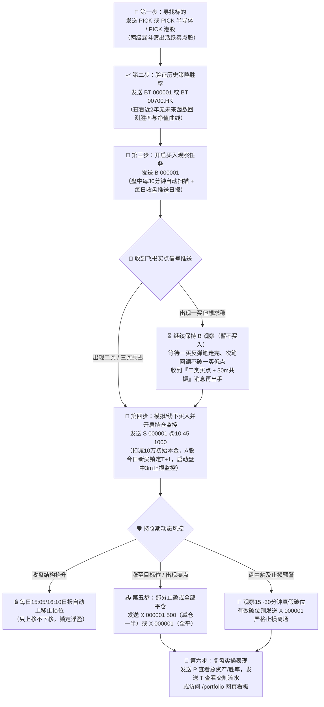

# astock-analyzer · A股 + 港股 缠论智能投研与实操系统

通过飞书机器人（支持**私聊**与**群聊 `@分析助手`**），提供**沪深京 A 股 + 港股**的**多级别缠论（缠中说禅理论）技术分析**、**两级漏斗智能选股 (`PICK`)**、**无未来函数历史回测 (`BT`)**、**10 万 RMB 模拟实操账本 (`S/X/P/T`，含 A 股 T+1 机制)**、**每日 08:00 市场信息早报**以及**全市场智能投研 Agent 自由问答**。

> ⚠️ 本项目所有分析结果与模拟回测数据仅供参考，不构成投资建议。

---

## 一、核心实战全流程作战图

从「找票 → 验胜率 → 盯买点 → 建仓风控 → 分批止盈/平仓 → 复盘账本」的完整实操闭环如下：



---

## 二、缠论实战盯盘 SOP 与核心问题解答（必读指南）

### 1. 发送 `B <代码>` 开启买入观察后，应该怎么关注飞书消息？
发送 `B 000001` 后，系统会在**两个维度**为你盯盘，两类消息的定位与应对方式不同：

| 消息类型 | 推送时间 | 卡片特征 | 你该如何应对？ |
|---|---|---|---|
| **⏱ 盘中买点信号** | 交易时段每 30 分钟检查（A股 `10:01~14:31`，港股至 `15:31`） | **仅在出现买点时推送**（无买点完全静默不打扰）：<br>• 橙色卡片 = 日线初现买点，但 30 分钟尚未向上共振<br>• 红色卡片 = 日线买点 + 30 分钟向上共振确认 | **准备与观察信号**：收到橙色卡先加入盯盘关注；收到红色共振卡可结合卡片上的「5分钟精确入场区间」准备分批介入。 |
| **📅 收盘日报（买入跟踪）** | A股每交易日 **15:05**<br>港股每交易日 **16:10** | 每天固定推送 1 张完整复盘卡（此时当日日线 K 线已彻底收盘定型） | **最终确认信号**：缠论日线级别分型与买卖点在收盘后才 100% 锁定。稳健型操作者以收盘日报确认的买点作为次日早盘介入依据。 |

---

### 2. 如果出现了「一类买点」但不放心（怕抄底半山腰），想等更稳的「二类买点」，应该等什么消息？
在缠论中，**「一买」是下跌趋势末端的背驰抄底点（赔率高但容易遇到背驰延伸），「二买」是一买反弹后的首次回调确认点（右侧确认，安全性最高）**。
如果你看到系统提示「一类买点」但想求稳等「二买」，**请不要取消 `B` 任务**，按以下三步等待飞书消息：

```text
         /\  ① 一买后先走出一笔向上反弹(离开最低点 P1)
        /  \
       /    \      /
      /      \    /  ③ 当收到飞书推送【二类买点 + 30分钟向上共振确认】时 → 右侧安全入场点！
     /        \  /
    /          \/  ② 随后走出一笔向下回调，最低点 P2 守住不跌破 P1（高于 P1）
   /
  ▼ P1 (一买最低点)
```

1. **第一阶段（放过一买，看反弹力度）**：收到「一类买点」后先不动手，在后续几天的 `15:05/16:10` 日报中观察日线「当前笔」是否顺利转为**向上笔**，最好能触及或突破前一个下跌中枢下沿。
2. **第二阶段（耐心等向下回调笔）**：向上反弹笔结束后，股价会再次回落走出**向下笔**。此时重点看飞书卡片顶部的 **「🟢 下方支撑位」**（通常锚定在一买前低附近）。
3. **第三阶段（出手信号）**：当回调不破一买最低点，且飞书向你推送 **「✅ 日线出现二类买点｜30分钟共振：已确认」**（红色卡片）时，说明空头二次下探衰竭，这就是你等待的右侧高胜率入场点！

---

### 3. 什么情况说明之前的「一类买点」是不准确的（买点证伪 / 信号失效）？
缠论走势是动态生长的（即 `chan.py` 的“当前帧”特性）。出现以下 **3 种情况之一**，即说明此前的一买被市场证伪（不成立）：

1. **直接跌破一买底分型最低点（最明确的证伪）**
   - 一买成立的前提是底分型最低点不再被跌破。如果后续 K 线直接放量跌穿了当时一买卡片给出的 **「🛑 止损位 / 笔低点」**，原来的向下笔将继续向下延伸（称为“盘整背驰转下跌”或“背驰段延伸”），此时再次查询 `Q 代码` 或看当日日报，会发现原来的「一类买点」已消失变为「无信号」。
2. **一买后的向上反弹连 30 分钟次级别中枢都无法突破，随即掉头破底**
   - 真正有效的一买，反弹至少应展现出次级别（30分钟）的凌厉脱离。如果一买出现后连续多日横盘阴跌、连 5 日均线或最近的压力位都摸不到，说明多头毫无承接力，极易演变为下跌中继。
3. **如果你已经在一买试错建仓（发了 `S`），系统会如何保护你？**
   - 一旦价格跌破一买底分型下方的结构止损位，系统的 **盘中每 3 分钟止损监控** 会立即向你弹出橙色 **「🚨 止损触发」** 告警卡片。**一买试错的核心铁律就是：一旦破底证伪，绝不硬扛，立即发 `X 代码` 止损离场，等待新的底背驰结构重新形成。**

---

### 4. 持仓期间（`S` 任务）如何利用系统消息做分批止盈与风控？
当你线下/模拟买入并发出 `S 600519 @1200 100` 后：
- **自动保护利润（止损棘轮只上移不下移）**：随着股价上涨、缠论中枢与线段低点抬高，每天 `15:05/16:10` 的持仓日报会自动重算结构止损位并提示 `🔒 止损上移：1160 → 1230`，帮你把浮盈锁死。
- **收到卖点信号时分批减仓（`X` 部分卖出）**：
  - 当收盘日报或盘中分析提示 **「⚠️ 日线出现一类卖点 / 二类卖点」** 或股价触及卡片上的 **「🎯 目标位」** 时，你可以发送 `X 600519 50`（按现价先卖出一半锁定利润），剩余 50 股让利润奔跑，直到跌破上移后的止损位再发 `X 600519` 全部清仓。

---

## 三、全量快捷指令速查表

| 指令格式 | 功能说明 | 示例 |
|---|---|---|
| `PICK [板块名/港股]` | **两级漏斗缠论智能选股**：第一层筛主力资金/强势板块，第二层并发跑缠论与历史回测胜率校验 | `PICK`<br>`PICK 半导体`<br>`PICK 港股` |
| `BT <代码> [年数]` | **无未来函数缠论回测**：基于 `chan.py` 逐根 K 线回放（默认近2年），返回胜率卡片 + HTML 净值曲线报告 | `BT 000001`<br>`BT 00700.HK 3` |
| `Q <代码>` | **即时多级别缠论分析**：返回 Schema 2.0 仪表盘卡片 + 买卖点三步决策推导链 | `Q 000001`<br>`Q 01810.HK` |
| `B <代码>` | **创建买入观察跟踪**：盘中每 30 分钟扫描买点 + 每日收盘推送日报 | `B 600519`<br>`B 00700` |
| `S <代码> [@买入价] [股数]` | **模拟买入建仓/加仓 & 开启止损监控**：扣减 10 万 RMB 初始本金（不填价取实时现价，不填量默认 100 股；已有持仓则加权加仓；A股新买当日受 T+1 限制） | `S 000001 @10.45 1000`<br>`S 01810.HK @25.5 400`<br>`S 000001 500` |
| `X <代码> [@卖出价] [股数]` | **模拟卖出减仓 / 全部平仓**：严格校验 A 股 T+1（港股 T+0）；不填价取实时现价，不填股数默认卖出全部可卖股数；全平后自动关闭 `S` 监控 | `X 000001`（现价全平）<br>`X 000001 500`（现价卖500股）<br>`X 000001 @11.5 500` |
| `P` | **查看模拟账户总览**：展示 10 万初始本金、当前总资产、可用现金、累计总收益、平仓胜率、持仓可卖/冻结股数 + 网页看板链接 | `P` |
| `T [代码]` | **查看模拟交易流水**：展示最近建仓、加仓、部分减仓、全部平仓的交割明细 | `T`<br>`T 000001` |
| `L` / `C <代码>` | **列出活跃跟踪任务** / **取消跟踪任务** | `L`<br>`C 000001` |
| `今日早报` / `开启早报` / `关闭早报` | **每日 08:00 市场信息早报**：查看华尔街见闻早餐一页 HTML 可视化市场地图，或开关每日推送 | `今日早报`<br>`关闭早报` |
| `M [provider] [model]` | **查看/切换模型**：DeepSeek 固定使用旗舰深度思考模型 `deepseek-v4-pro` | `M` |
| `H` / `帮助` / `?` | **查看指令帮助** | `H` |

---

## 四、Web 可视化页面与 ECS 数据库远程访问指南

系统内置轻量 Web 服务（ECS 80 端口），所有页面均做 SQLite + 磁盘双重持久化，重启绝不丢失：

| 页面地址 | 说明 |
|---|---|
| `http://8.153.91.185/portfolio` | **10万本金模拟实操账户看板**：总资产、收益率、胜率、当前持仓表（含 T+1 冻结状态）、历史交割流水 |
| `http://8.153.91.185/backtests/<代码>_2y` | **单股缠论无未来函数回测报告**：策略净值 vs 基准对比曲线、分买点类型胜率、历次买卖交割单 |
| `http://8.153.91.185/briefings` | **每日 08:00 华尔街见闻早餐 · 全球市场可视化地图归档** |

### 如何使用本机 Navicat 或 CLI / Agent 访问线上 ECS 数据库？

线上 SQLite 数据库位于 ECS `/opt/astock-analyzer/data/astock.db`（包含 `accounts`、`positions`、`trade_logs`、`tasks`、`morning_briefings`、`backtest_reports`、`chat_history` 等全部表）。为避免远程直接锁死正在写入的 WAL 文件，项目提供了 `scripts/ecs_db.py` 工具：

```powershell
# 1. 一键在线热备同步线上数据库到本地 (耗时 ~1 秒，零锁表风险)
.\.venv\Scripts\python.exe scripts\ecs_db.py sync
# 同步后文件位于: E:\Project\astock-analyzer\data\ecs_mirror.db
# 👉 打开本机 Navicat -> 新建连接 -> SQLite -> 选择现有数据库文件 E:\Project\astock-analyzer\data\ecs_mirror.db 即可直观查看所有表！

# 2. 在本机终端或让本地 Agent 直接执行远程 SQL 查询
.\.venv\Scripts\python.exe scripts\ecs_db.py tables
.\.venv\Scripts\python.exe scripts\ecs_db.py query "SELECT stock_code, stock_name, avg_cost, current_qty, realized_pnl_rmb FROM positions"
```

---

## 五、智能投研 Agent 自由问答能力（12 大内置工具）

除快捷指令外，发送任意自然语言问题均可触发 Agent 自动调用工具解答（保留最近 20 轮会话记忆）：
1. **无代码连续追问**：发完 `Q 01810.HK` 后直接问 *“它为什么还不算底背驰？跌破支撑怎么办？”*
2. **选股与回测问答**：*“帮我扫描一下今天半导体板块里有没有缠论买点的股票？”* / *“帮我回测一下比亚迪过去 2 年按缠论买卖点的胜率是多少？”*
3. **账户实操复盘**：*“帮我看看我现在的模拟账户持仓里哪只票风险最大？总收益怎么样？”*
4. **大盘、情绪、板块资金与新闻**：*“今天大盘和恒生科技止跌了吗？主力资金在流入哪些板块？”*
